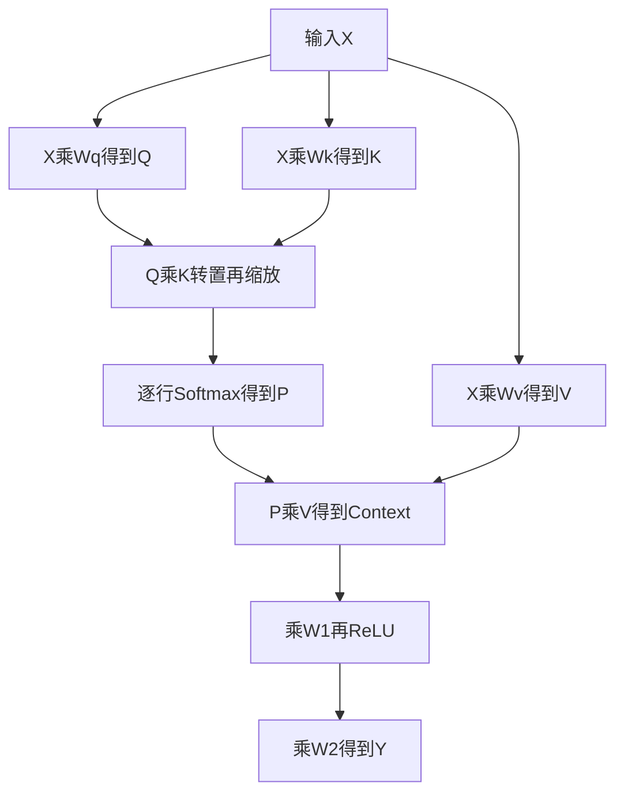
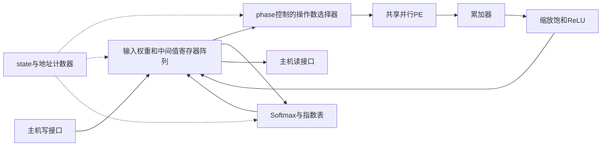

# RTL 逐文件详解：从数据到电路

对应本工程当前四个 Verilog 文件及 files.f。先读概念，再按 pe_array → exp_lut → softmax_unit → transformer_top 顺序看。本文解释现有实现，不修改 RTL，也不代表已经完成实验室综合。

## 0. files.f 是什么？与 IP、BRAM 有什么关系？

实际文件名是 `rtl/files.f`，不是 flie.f。它是普通文本文件，内容为：

```text
rtl/pe_array.v
rtl/exp_lut.v
rtl/softmax_unit.v
rtl/transformer_top.v
```

它像“做菜的材料清单”：告诉编译工具需要读哪些源码。它自身不执行计算、不产生存储器、不占硬件面积。

| 名称 | 是什么 | 在当前项目中 |
| --- | --- | --- |
| files.f | 编译文件清单 | 列出四个 RTL 路径 |
| .v | Verilog 源码 | 描述将被实现的电路 |
| IP 核 | 可复用的功能设计，可以是源码，也可以是工具提供的模块 | 我们写的模块可作为自研可复用设计，但 files.f 不是 IP 核 |
| BRAM | FPGA 芯片内预先制造的块存储资源 | 当前没有实例化 FPGA BRAM IP |
| ASIC SRAM 宏 | 工艺提供的存储电路块，需模型、逻辑库及物理资料 | 当前未接入 |
| Testbench | 仿真时的驱动和检查程序 | tests/default/tb.sv，不综合进芯片 |

文件清单只有被工具明确读取才生效。例如在项目根目录，Icarus 可用 `iverilog -g2012 -s transformer_top -f rtl/files.f` 读取它；这里仅说明命令含义，不是功能自检命令。相对路径按工具工作目录解析，本清单要求从项目根目录运行。

当前 Python 测试脚本、VCS 脚本和 DC 脚本各自显式列出了四个源码，**没有自动读取 files.f**。修改清单不会自动改变这些脚本的编译输入，新增模块时要同步更新各入口。

`reg [7:0] mem[0:31]` 只是声明一个存储数组，不能据此判断一定得到 BRAM。实际映射依赖目标器件、读写端口、时序写法和综合工具。本工程按寄存器存储基线设计；多路组合读和写入逻辑也不能直接等同于普通单/双端口 BRAM。

## 1. 先认几个基础语法

- `module ... endmodule`：定义一块电路的边界。
- `input/output`：模块与外部连接的端口。
- `parameter`：构建电路时确定的参数，不是运行时输入。
- `[7:0]`：8 根二进制信号线。`signed` 表示按补码解释正负。
- `wire`：连接关系；`reg` 表示过程块赋值的变量，不等于必然有触发器。
- `always @*`：组合逻辑，输入变了就重新求值，不等下一拍。
- `always @(posedge clk ...)`：时序逻辑，在时钟上升沿更新状态。
- 组合块常用 `=`，时序块用 `<=`。非阻塞赋值右侧取当前旧值，更新在本拍稍后生效，不能当软件顺序赋值理解。

可以把组合电路想成传动齿轮，输入变化会传到输出；时序寄存器像每到一拍才关门保存一次的储物柜。

## 2. pe_array.v：几个人同时做乘法，再把答案相加

### 端口与位宽

```verilog
module pe_array #(parameter LANES=2)(
    input [LANES*18-1:0] a, b,
    output reg signed [63:0] sum
);
```

LANES=2 时 a、b 各36位，每条总线装两个18位数。不是一个36位数乘另一个36位数，而是两对18位数分别相乘。

主计算是 INT8，但注意力概率需要容纳正数32768，所以共享 PE 输入用了 signed 18位。8位有符号数送来时会符号扩展，概率送来时先补零。

### 临时量

```verilog
integer lane;
reg signed [17:0] av, bv;
reg signed [35:0] product;
```

lane 用来描述各路运算；av/bv 是当前一路操作数。18×18位乘法的完整结果用36位容纳。

### 组合块与循环

```verilog
always @* begin
    sum=0; av=0; bv=0; product=0;
    for(lane=0;lane<LANES;lane=lane+1) begin
        av=$signed(a[lane*18 +: 18]);
        bv=$signed(b[lane*18 +: 18]);
        product=av*bv;
        sum=sum+{{28{product[35]}},product};
    end
end
```

初始赋零给所有路径一个确定值，避免组合逻辑保留旧值形成锁存器。硬件循环在综合时按固定 LANES 展开，不是“一个乘法器花两拍执行 for”。

`[lane*18 +: 18]` 表示从 lane×18 这一位开始取18位。lane=0取[17:0]，lane=1取[35:18]。`$signed` 告诉工具将切片按有符号数处理。

`{{28{product[35]}},product}`：把符号位复制28次，拼到36位乘积前，变成64位并保持原来正负数值。这叫符号扩展。

例如 a 两路为[2,-3]，b为[4,5]，输出是2×4+(-3)×5=-7。此模块没有 clk，只有组合乘法与求和；跨拍累加由顶层完成。当前也不是二维脉动阵列。

## 3. exp_lut.v：不用现场算指数，直接查答案表

模块输入 `delta[7:0]`，输出 `value[16:0]`。输入含义是“本行最大得分与当前得分相差多少”，并以1/16为一步。

表项遵循：

```text
value = floor(exp(-delta/16) × 65536 + 0.5)
```

例子：delta=0表示与最大值相同，输出65536，代表1；delta=16表示真实差值1，输出约24109，代表exp(-1)。差得越远，指数越小。

```verilog
always @* begin
    case(delta)
        8'd0: value=17'd65536;
        8'd1: value=17'd61565;
        ...
        default: value=0;
    endcase
end
```

case 的每一行只是一个“输入编号→预先算好答案”的映射。256行不必逐行背；知道公式、输入范围、输出缩放和边界即可。default 保证组合输出有默认值；正常已知的8位输入均有表项。

为什么输出17位？16位无符号最大65535，装不下65536。

表由 `scripts/generate_lut.py` 离线生成，芯片不运行 Python，也不现场调用 exp。硬件综合后可能成为ROM或逻辑网络，不能只凭 LUT 名称写成 FPGA BRAM；这里 LUT 指函数查表，不特指 FPGA 的基本逻辑单元。

## 4. softmax_unit.v：把匹配分数变成关注比例

### 算什么

一行分数 s 先减去行最大值 m，再算指数并归一化：

```text
delta[j] = m - s[j]
e[j] = round(exp(-delta[j]/16) × 65536)
p[j] = floor(e[j] × 32768 / sum(e))
```

减最大值不改变理想实数 Softmax 的比例，同时指数不超过1。像给几个人分一块蛋糕：先算每个人的份额依据，再除以总份额，得到各自比例。

### 接口方向

| 端口 | 谁送给谁 | 意义 |
| --- | --- | --- |
| start | 顶层→Softmax | 开始处理一行 |
| read_addr | Softmax→顶层 | 请给我这行第几个分数 |
| logit | 顶层→Softmax | 该位置的8位有符号分数 |
| valid | Softmax→顶层 | 本拍输出有效 |
| index | Softmax→顶层 | 输出属于这一行的哪个位置 |
| prob | Softmax→顶层 | 16位无符号概率原码，真实比例=prob/32768 |
| done | Softmax→顶层 | 此行最后一个结果已经输出 |

本模块不保存整行，只发地址，由顶层 score 数组提供数据。这里假设读分数是组合读；若以后换同步 SRAM，必须适配一拍或多拍读延迟。

### 位宽与计算关系

`ptr` 是当前列指针；`maximum` 用 signed 9位。`extended` 将8位 logit 符号扩展到9位。-128到127之间最大差值255，因此 difference 用9位计算后，查表取低8位；在最大值已找完的有效指数阶段，差值保证落在0..255。

`denominator` 是指数和，32位。N≤64时最大64×65536=4194304，能容纳。`numerator` 先把指数扩到48位再左移15位，即乘32768，避免窄位宽左移截断。

### 四个状态逐拍解释

| state | 每拍动作 | 行末动作 |
| --- | --- | --- |
| 0 | 等start；收到后清ptr、分母，最大值设-128 | 转1 |
| 1 | 比较当前logit和maximum，记录较大值 | ptr归0，转2 |
| 2 | 查e并加到denominator | ptr归0，转3 |
| 3 | 输出当前e×32768/denominator，置valid | 最后一个置done，回0 |

每行三遍，每遍N拍。最大值至少对应一个指数65536，所以正常数据下分母不为0。每拍默认 `valid<=0; done<=0;`，输出状态再覆盖valid；done只在最后一个结果那拍置1。

`prob<=numerator/denominator` 在当前写法中是除法组合路径，结果在该上升沿寄存。源码一行不意味着面积小或时序一定能过；是否改为多拍除法要看真实综合报告。

### 一个能算清的例子

N=2，两分数均为0：找最大值得0；两指数均65536；分母131072；每个概率为65536×32768/131072=16384，代表0.5。

N=1时唯一概率为32768，代表1。这就是概率不能用signed 16位解释的原因：其位型0x8000按signed看会变成-32768。

## 5. transformer_top.v：仓库管理员、搬运工和总调度

顶层负责存数据、选操作数、累加、保存结果、安排先后顺序。PE是计算工，Softmax是专门做归一化的工位，顶层像发工单的车间主任。

### 5.1 参数

| 参数 | 默认 | 意义 |
| --- | ---: | --- |
| N | 4 | 序列位置数，矩阵行数 |
| D | 8 | 每位置的特征数 |
| F | 16 | FFN中间维度 |
| LANES | 2 | 每次处理多少对乘法 |
| PROJ_SHIFT | 4 | QKV投影后右移位数 |
| SCORE_SHIFT | 4 | 得分定点缩放的一部分 |
| FF_SHIFT | 4 | FFN乘法后右移位数 |
| SCALE | 181 | round(512/sqrt(8))，近似注意力缩放系数 |
| SCALE_SHIFT | 9 | 将SCALE的512倍缩放还原 |

SCALE不会随D自动计算，改变D时必须一起调整。参数在综合/展开时确定，不是主机每次start能动态改变。

### 5.2 外部端口

clk上升沿采样，rst_n为低有效异步复位。先写完整输入及权重，再脉冲start，等done，最后读结果。

```text
加载数据 → start一拍 → busy持续为1 → done一拍/busy回0 → 读回结果
```

wr_bank选存储区，wr_addr选其中元素，wr_data是8位有符号数据。rd_bank/rd_addr选读出内容，rd_data组合输出32位结果。cycles计计算拍数，不含主机加载与读回。

### 5.3 数组就是装数字的抽屉

| 数组 | 形状 | 用途 |
| --- | --- | --- |
| x | N×D | 输入特征 |
| wq/wk/wv | 各D×D | 生成三种特征的权重 |
| w1 | D×F | FFN第一层权重 |
| w2 | F×D | FFN第二层权重 |
| q/key/v | 各N×D | 投影结果 |
| score | N×N | 每位置对每位置的得分 |
| probability | N×N | 归一化关注权重，16位无符号 |
| context_mem | N×D | 汇总其他位置信息后的结果 |
| hidden | N×F | FFN中间激活 |
| result | N×D | 最终输出 |

除probability外，这些数组元素都是signed 8位。二维矩阵被展开成一维，地址=行×列数+列。例如D=8时，x[2*8+3]是第2行第3列，行列都从0计。

### 5.4 state、phase与地址计数器

state是工作状态：IDLE、MAC、SM_START、SM_WAIT。phase是MAC当前做哪个算子。row/col选输出元素，pos是点积已经走到哪个位置，idx=pos+lane是当前一路的特征下标。

inner_dim是一个输出元素需要多少个乘积，columns是输出矩阵每行多少列；多数情况为D，phase 3/4/5/6按算子改成N或F。

```text
把点积想成核对一张长账单：
row/col决定正在算哪张账单，pos决定算到第几项，LANES决定每次同时核对几项。
```

### 5.5 加法线和sat8

`partial_sum` 是PE当前这组乘积之和；`accumulator`保存之前几拍的和；`total=accumulator+partial_sum`包含当前拍的结果。`scaled=total*SCALE`供注意力得分使用。

sat8函数把结果夹到[-128,127]，超过127返回0x7f，低于-128返回0x80，否则保留低8位。直接截位可能把大正数变负数；饱和相当于量杯满了就停在上限。

### 5.6 两个子模块实例

`pe_array #(.LANES(LANES)) pe(...)`：顶层参数传给PE；a/b连接打包操作数，sum连接partial_sum。

Softmax的start接 `state==SM_START`；`sm_read`返回后，顶层通过 `score[row*N+sm_read]`提供当前行分数。`sm_index/sm_value/sm_valid`用于回写概率，sm_done推动切行或进入Context。

### 5.7 第一个组合块：根据phase选乘法数据

| phase | aa | bb | 实际运算 |
| --- | --- | --- | --- |
| 0 | X[row,idx] | Wq[idx,col] | Q=XWq |
| 1 | X[row,idx] | Wk[idx,col] | K=XWk |
| 2 | X[row,idx] | Wv[idx,col] | V=XWv |
| 3 | Q[row,idx] | K[col,idx] | QK转置 |
| 4 | P[row,idx] | V[idx,col] | Context=PV |
| 5 | Context[row,idx] | W1[idx,col] | FFN第一层 |
| 6 | Hidden[row,idx] | W2[idx,col] | FFN第二层 |

phase3中K的地址为 `key[col*D+idx]`，通过读K的一行实现与K转置的一列相乘，不需要真搬一次转置矩阵。

phase4用 `$signed({2'b00,probability[...]})`，先补零再转signed18位，保证概率32768仍为正数。aa/bb随后打包到pe_a/pe_b各路切片。

`idx<inner_dim` 判断用于尾部不足LANES时补零；例如D=5、LANES=2，最后一拍只有第4项有效，另一路为0。非MAC状态所有PE输入也给0。

### 5.8 第二个组合块：外部读回

rd_bank=0..7分别读result、q、key、v、score、probability、context_mem、hidden。非法地址返回0。有符号8位数据扩展成signed32位，probability补零到32位。

这是观测窗口，像从仓库里选一个抽屉看数字，不是自动把整个矩阵传出。完成前中间数据可能没写完，正式结果应在done后读取。

### 5.9 时序块：复位、加载和启动

复位清state、phase、row/col/pos、accumulator、done、cycles，**不清矩阵数组**。上电后数据可能未知，必须先加载；中断复位后可以复用已完整加载的数据，但要重算后再使用输出。

主机写只有 `wr_en && state==IDLE && !start` 时接受。写bank0..5分别是X、Wq、Wk、Wv、W1、W2。非法bank或越界忽略。

启动只有 `state==IDLE && start && !wr_en` 时接受，同时清计数器，进入phase0。start和wr_en同时为1时，两者都不接受；busy期间写入和重启都忽略。

`busy=(state!=IDLE)` 是组合状态指示。`done<=0` 为默认值，最后算完时才置1，形成单拍完成脉冲。start应由外部只拉一拍；若一直拉高，计算结束回到IDLE后可能再次启动。

### 5.10 MAC状态：最重要的几行

```verilog
if(pos+LANES>=inner_dim) begin
    // 本元素的最后一组：写量化结果，清累加器，换元素
end else begin
    accumulator<=total;
    pos<=pos+LANES;
end
```

不是最后一组就保存和、继续点积。最后一组用total而非accumulator写回，保证包含本拍乘积。写回规则：Q/K/V和FFN右移；score先乘SCALE再右移；Context右移15；Hidden负值置0即ReLU。

一个元素结束后pos、accumulator清零。先col加1，列满再row加1，所有行列算完才换phase。最后的非阻塞写回会在本拍结束生效，下一阶段下一拍读取新结果。

phase3结束进入Softmax；phase6结束回IDLE并置done；其余phase依次加1。

### 5.11 Softmax调度

SM_START持续一拍，通知Softmax开始本行；随后SM_WAIT等待。sm_valid时把概率写 `probability[row*N+sm_index]`。sm_done时，若还有行就row加1回SM_START，否则row归0、phase设4、进入MAC算PV。

两个模块在同一时钟沿使用非阻塞赋值，顶层看到的是Softmax上一拍寄存出来的valid/done和数据；因此不要把模块间握手当成软件函数立即返回。最后一个valid和done同时到达时，先前行号仍用于最后一次回写，随后才切换行号。

## 6. 用一个点积把四个文件串起来

取默认D=8、LANES=2，计算Q[0,0]。设X第0行全部raw16（真实值1），Wq第0列全部raw8（真实值0.5）。

| MAC拍 | pos | 本拍PE结果partial_sum | total | 动作 |
| --- | ---: | ---: | ---: | --- |
| 1 | 0 | 16×8+16×8=256 | 256 | 保存accumulator=256 |
| 2 | 2 | 256 | 512 | 保存512 |
| 3 | 4 | 256 | 768 | 保存768 |
| 4 | 6 | 256 | 1024 | 右移4得64，写Q[0,0] |

raw64代表64/16=4，等于8个1×0.5之和。写完col变1，继续Q[0,1]；所有Q完成再算K，然后V。

Q/K用来打分，V用来提供被加权汇总的内容。例如一行P=[0.5,0.5]，两个V位置为[2,4]、[6,8]，汇总Context=[4,6]。这是形象的实数例子，RTL实际用整数缩放表示这些数。

## 7. 画图时分别画两张

算法图：



硬件图：



算法图多处出现乘法，不意味着硬件图有七套PE。默认只有一套共享PE，phase轮流安排工作。

## 8. 其余文件各自干什么

| 文件 | 运行在哪里、作用 |
| --- | --- |
| scripts/generate_lut.py | 电脑运行，生成256项指数表源码 |
| scripts/golden.py | 电脑运行，用NumPy计算与RTL相同量化规则的预期结果 |
| scripts/run_tests.py | 电脑运行，造输入、生成Testbench、调用Icarus、逐阶段比对，写日志 |
| scripts/test_softmax.py | 单测Softmax和指数表，包括均匀值、极值和随机分数 |
| scripts/synth_check.py | 调Yosys查层次、驱动和锁存器；不是实验室PPA |
| tests/default/tb.sv | 仿真驱动：加载矩阵、启动、等待、读八个bank并检查结果 |
| tests/default/input.hex | 预先准备的输入与权重数据，十六进制文本 |
| tests/default/expected.hex | Golden生成的期望输出，用于比较 |
| lab/run_vcs.sh | Linux shell脚本：组织VCS编译和仿真输出目录 |
| lab/dc_synth.tcl | DC工具内运行的Tcl：读库、读RTL、设约束、综合、导出网表和报告 |

这些Python、shell、Tcl脚本以及Testbench都不是加速器芯片里的运算电路。真正送去综合的设计主体是四个RTL文件。DC脚本中的默认周期/负载是待核对的约束，不是实现后已测得的性能。

## 9. 读完应能回答的自测

1. files.f为何不能叫BRAM？它没有存储电路，只是一份文件路径清单。
2. PE自己有没有保存上拍和？没有，顶层accumulator保存。
3. 两路for是否表示两拍？不是，描述并行组合运算；点积跨拍由pos控制。
4. 为什么K地址写col×D+idx？取K的一行，完成与K转置一列的点积。
5. 为什么概率补两位0？使32768能作为正的signed18位数参与乘法。
6. 是否所有reg都会变触发器？不是，取决于过程和赋值方式。
7. 是否已证明最大尺寸和实际频率？没有，以测试范围和真实DC/ICC报告为准。

当前版本为学习与验证基线，不含完整模型的残差、LayerNorm、mask等；没有接SRAM宏，没有声明FPGA BRAM，也没有二维脉动PE阵列。掌握现有实现后再谈这些扩展。
