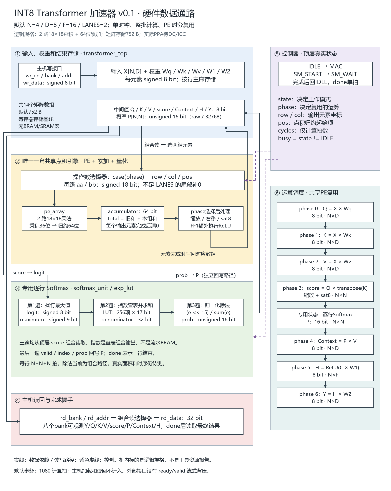
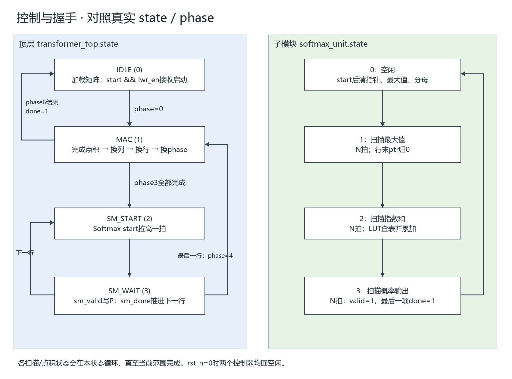

# INT8 Transformer 加速器 v0.1 设计文档

## 1. 修订记录与范围

| 版本 | 日期 | 内容 |
| --- | --- | --- |
| v0.1 | 2026-10-30 | 对照当前 RTL 整理端口、存储、定点算法、共享数据通路、状态及验证入口 |

本文沿用提供的《自然饱和度 v1.4》文档的组织方式和分组流程图风格。所有位宽、状态及运算来自本项目代码；图中的资源是逻辑规格，不能代替 Synopsys 综合或布局布线报告。

## 2. 概述

### 2.1 目标与模块定位

设计实现单头注意力和两层 ReLU 前馈计算：先从输入生成 Q/K/V，再计算注意力概率和加权结果，最后经过前馈网络生成 Y。默认 N=4、D=8、F=16、LANES=2。

这是一套便于仿真、观察中间结果及接入 ASIC 工具的寄存器存储基线。当前没有 bias、mask、残差、LayerNorm、多头拼接和注意力输出投影，因此不能直接等同于完整 Transformer 层。

形象地理解：矩阵是仓库，PE 是共用的计算工作台，`phase` 是当前加工单，`state` 是工作台在计算还是等待 Softmax。Q、K、V 是三批加工结果，不需要三套独立工作台。

### 2.2 文件与模块

| 文件 | 职责 | 状态与时钟 |
| --- | --- | --- |
| `rtl/transformer_top.v` | 主机接口、14个矩阵数组、选数、跨拍累加、量化、调度 | 有时钟；4个主状态、7个计算阶段 |
| `rtl/pe_array.v` | LANES路乘法及组内求和 | 纯组合，无内部状态 |
| `rtl/softmax_unit.v` | 一行数据的最大值、指数和、概率输出 | 有时钟；4个状态 |
| `rtl/exp_lut.v` | 将差值映射为定点指数 | 纯组合查表，无内部状态 |
| `rtl/files.f` | 按依赖顺序列出以上4个Verilog源文件 | 文本清单，不是硬件 |

`files.f` 类似“编译配料表”，工具读它后才知道要编译哪些文件。例如在仓库根目录，可将它交给支持 `-f` 的 Verilog 编译器。当前本地 Python 和实验室脚本使用显式源文件列表，修改清单时也需核对这些入口。

IP 核是可复用硬件设计模块；BRAM 是 FPGA 中的专用块存储资源。文件清单、IP、BRAM 是三个不同概念。当前四个模块是项目源码，没有实例化厂商 IP 或 BRAM。

## 3. 详细设计

### 3.1 硬件总览

实线表示读写或数据依赖，紫色虚线表示控制。右侧是运算顺序，左侧才是实际硬件分块。七个矩阵乘阶段均使用唯一实例 `pe`；Softmax 使用专门的 `sm` 和 `lut`。

图中矩阵间的数据经过数组存放再取出，没有逐元素流式级联。输入和权重完整装载后启动，所有阶段完成后读回结果。

### 3.2 算法与矩阵形状

| 顺序 | 运算 | 输出形状 | 直观含义 |
| --- | --- | --- | --- |
| phase 0 | Q = X × Wq | N×D | 每个token想寻找什么 |
| phase 1 | K = X × Wk | N×D | 每个token可被匹配的特征 |
| phase 2 | V = X × Wv | N×D | 每个token实际提供的内容 |
| phase 3 | score = scale(Q × K转置) | N×N | 第r个token对第c个token的匹配程度 |
| 独立Softmax | P = softmax(score)，逐行 | N×N | 每行的关注权重 |
| phase 4 | C = P × V | N×D | 根据关注权重汇总内容，C即Context |
| phase 5 | H = ReLU(C × W1) | N×F | 扩展中间特征并抑制负值 |
| phase 6 | Y = H × W2 | N×D | 投影回D维，形成最终输出 |

以上是算法记号；实际整数移位、饱和规则见第4节。Q/K/V的“查询、键、值”是帮助理解的比喻，不代表RTL理解自然语言。

例如 N=4 时，score有4行4列。`score[1,2]`来自Q第1行和K第2行的点积；P第1行的4个概率决定C第1行如何混合V的4行。所有下标从0开始。

### 3.3 存储与地址

二维矩阵按行主序展开：`addr = row * 列数 + col`。地址是bank内的元素下标；概率虽然16位，地址仍按元素递增。

| 数组 | 形状 | 元素位宽 | 默认字节数 |
| --- | --- | --- | --- |
| x | N×D | signed 8 | 32 |
| wq / wk / wv | 各D×D | signed 8 | 各64，共192 |
| w1 / w2 | D×F / F×D | signed 8 | 各128，共256 |
| q / key / v | 各N×D | signed 8 | 各32，共96 |
| score | N×N | signed 8 | 16 |
| probability | N×N | unsigned 16 | 32 |
| context_mem | N×D | signed 8 | 32 |
| hidden | N×F | signed 8 | 64 |
| result | N×D | signed 8 | 32 |
| 合计14个数组 | — | — | 752 |

矩阵容量公式为 `6ND + 3D² + 2DF + NF + 3N²` 字节。该值不含控制寄存器、累加器和指数查表。数组目前采用组合读、时序写的描述方式；综合后如何映射及实际面积需要工具报告，不能把752 B直接写成某个BRAM数量。

### 3.4 共享点积引擎

操作数选择器依据 `phase / row / col / pos`，每拍取LANES对元素。INT8符号扩展为18位；概率P先补零成为正的18位有符号数。

`pe_array` 将每路18×18乘积扩展到64位并求和，得到 `partial_sum`。顶层执行 `total = accumulator + partial_sum`。若尚有元素，则保存total并令pos增加LANES；若已到末组，则对total量化写回，并清累加器处理下一个输出元素。

例如D=8、LANES=2，一个长度8的点积需要4拍，pos依次为0、2、4、6。最后一拍写回包含当前乘积的total，避免漏掉末组。长度不能整除LANES时，越界路补0。

循环顺序是：完成一个点积→下一列→下一行→下一phase。K转置通过地址 `key[col*D+idx]` 实现，未另外复制一份转置矩阵。

### 3.5 Softmax

Softmax每行扫描三遍，输入由顶层根据 `read_addr` 组合读取score：

1. N拍找最大值m，9位有符号量保存m。
2. N拍计算delta=m-logit，查17位指数表并累加到32位denominator。
3. N拍逐项计算概率，使用valid/index/prob写回P；最后一项同时给出done。

差值范围0..255；至少最大项的指数为65536，合法输入下分母非零。查表是组合case，不是带读延迟的同步ROM。概率归一化当前使用组合除法，可能成为面积和时序重点，尚未实现多拍除法器。

### 3.6 控制状态

| 顶层state | 编码 | 工作 | 离开条件 |
| --- | --- | --- | --- |
| IDLE | 0 | 接收写入或启动 | start=1且wr_en=0进入MAC，phase=0 |
| MAC | 1 | 共享点积、量化、写回 | phase3全部完成进SM_START；phase6完成回IDLE并发done；其他计算继续MAC |
| SM_START | 2 | 对Softmax提供单拍启动 | 下一拍进入SM_WAIT |
| SM_WAIT | 3 | 接收概率 | 一行完成后启动下一行；最后一行完成则phase=4进入MAC |

`phase`的0..6对应第3.2节；它不是另一套7状态主FSM。`row/col`表示当前输出坐标，`pos`表示点积内下一组的起点，`inner_dim`是点积长度，`columns`是输出列数。

Softmax内部状态0空闲、1找最大值、2求指数和、3输出概率。扫描状态中每拍推进ptr，到行末清ptr并换状态。顶层等待子模块，两个控制器协同完成整批计算。

## 4. 定点数、位宽与边界

### 4.1 数值约定

INT8矩阵以raw/16解释；概率以raw/32768解释，32768表示1。以下乘加符号均指对整数原码运算，`sat8`钳位到[-128,127]，`>>>`为算术右移。

| 结果 | 实际整数规则 |
| --- | --- |
| Q / K / V | sat8(sum(Xraw × Wraw) >>> PROJ_SHIFT) |
| score | sat8((sum(Qraw × Kraw) × SCALE) >>> (SCALE_SHIFT + SCORE_SHIFT)) |
| 指数e | round(exp(-delta/16) × 65536)，表中为17位无符号 |
| P | floor((e × 32768) / sum(e))，16位无符号 |
| C | sat8(sum(Praw × Vraw) >>> 15) |
| H | total<0时为0，否则sat8(total >>> FF_SHIFT) |
| Y | sat8(sum(Hraw × W2raw) >>> FF_SHIFT) |

默认PROJ_SHIFT=SCORE_SHIFT=FF_SHIFT=4，SCALE_SHIFT=9，SCALE=181，近似512/sqrt(8)。改变D时需要同步设置SCALE；RTL不会自动计算平方根。

右移不执行四舍五入，对负数按算术移位向负无穷取整。输出阶段做饱和，而非直接截取低8位。Softmax概率各项独立整除，行和可能略小于32768，不做末项补差。

### 4.2 关键位宽

| 信号 | 位宽 | 目的 |
| --- | --- | --- |
| aa / bb | signed 18 | 统一承载INT8和最大32768的概率 |
| product | signed 36 | 完整乘积 |
| partial_sum / accumulator / total | signed 64 | 组内求和及跨拍累加 |
| maximum / difference | 9 | 有符号最大值及0..255差值 |
| exponential | unsigned 17 | 可表示65536 |
| denominator | unsigned 32 | 指数和；N<=64时不超过4194304 |
| numerator | unsigned 48 | 容纳指数左移15位 |

当前目标范围N<=64、D<=256、F<=256，参数应为正整数且LANES>=1；这不是对所有组合已经通过测试的声明。最大D=256配置曾在Icarus编译阶段超时，未完成端到端验证。参数并无运行时合法性检查。

## 5. 模块拆分与资源、延迟

### 5.1 逻辑资源

默认共享PE有2路18×18乘法，另有64位求和/累加、阶段量化、常数缩放、Softmax除法和查表。指数表逻辑容量256×17=4352 bit。常数乘法能否化简、数组和除法如何实现，均由综合决定。

本设计面向标准单元ASIC流程，不直接套用参考视频设计的DSP/BRAM统计。当前没有实际DC面积、ICC面积/拥塞、关键路径和功耗结果，图中不能填写未经运行的资源数字。

### 5.2 计算拍数

令L=LANES，ceil为向上取整。计算计数包含Softmax握手，不含主机装载和读回：

`T = 3ND·ceil(D/L) + N²·ceil(D/L) + N(3N+2) + ND·ceil(N/L) + NF·ceil(D/L) + ND·ceil(F/L)`

| 阶段 | 默认拍数 |
| --- | --- |
| Q / K / V | 各128，共384 |
| score | 64 |
| Softmax及顶层握手 | 56 |
| Context | 64 |
| FF1 | 256 |
| FF2 | 256 |
| 合计 | 1080 |

默认每次完成2048次有效乘加；1080拍不等于已经达到某个频率。真实时间需用综合后可达频率计算。主机默认还需写入480个8位输入/权重元素。

## 6. 接口与使用协议

### 6.1 顶层端口

| 端口 | 方向/位宽 | 含义 |
| --- | --- | --- |
| clk | 输入1 | 上升沿工作时钟 |
| rst_n | 输入1 | 异步低有效复位；外部应同步释放 |
| start | 输入1 | 空闲时拉高一拍启动；同时要求wr_en=0 |
| wr_en | 输入1 | 空闲且start=0时写入一个元素 |
| wr_bank | 输入3 | 选择输入或权重数组 |
| wr_addr | 输入18 | bank内元素下标 |
| wr_data | 输入signed 8 | 写入的补码原码 |
| rd_bank | 输入3 | 选择读回数组 |
| rd_addr | 输入18 | 读回元素下标 |
| rd_data | 输出signed 32 | 组合读；INT8符号扩展，P补零，越界返回0 |
| busy | 输出1 | state不为IDLE时为1 |
| done | 输出1 | 全批完成时单拍为1，同时busy回0 |
| cycles | 输出32 | 启动时清零，忙时逐拍增加，完成后保持 |

| 写bank | 数组 | 合法地址 |
| --- | --- | --- |
| 0 | X | 0..ND-1 |
| 1 / 2 / 3 | Wq / Wk / Wv | 0..D²-1 |
| 4 | W1 | 0..DF-1 |
| 5 | W2 | 0..FD-1 |

| 读bank | 0 | 1 | 2 | 3 | 4 | 5 | 6 | 7 |
| --- | --- | --- | --- | --- | --- | --- | --- | --- |
| 数组 | Y | Q | K | V | score | P | Context | H |

使用顺序：复位→完整加载X与五组权重→停止写入→单拍start→等待done→选择读bank和地址读取。默认输入权重共480次写入。需要再次运行时可保留已加载数据，但新任务必须保证需要的元素有效。

复位只清控制，不清矩阵。忙时忽略start和写入；start与wr_en同拍为1时两者均不接受。done不是持续有效标志，应由外部捕获。读口一直可读，但完成前不能认为各bank都是本次事务的最终结果。没有ready/valid背压或AXI接口。

### 6.2 子模块端口

| 模块 | 端口 | 含义 |
| --- | --- | --- |
| pe_array | a / b，各LANES×18输入 | 打包操作数，最低18位是lane0，逐路按signed解释 |
| pe_array | sum，signed 64输出 | 当前一组乘积和；没有跨拍保存 |
| softmax_unit | clk / rst_n / start | 行级时钟、复位和启动 |
| softmax_unit | read_addr，16输出 | 请求本行第几个score，外部必须组合供数 |
| softmax_unit | logit，signed 8输入 | read_addr对应的score原码 |
| softmax_unit | valid，1输出 | 当前index/prob有效 |
| softmax_unit | index，16输出 | 当前概率在本行的位置 |
| softmax_unit | prob，16输出 | 当前概率原码 |
| softmax_unit | done，1输出 | 最后一个概率输出时的单拍结束信号 |
| exp_lut | delta，8输入 | 最大值减当前score |
| exp_lut | value，17输出 | 对应的定点指数，组合输出 |

## 7. IP与工艺流程接入

四个RTL模块之间直接例化，没有厂商乘法器、除法器或RAM宏。若后续改成同步SRAM，必须同时调整读延迟、选数、累加和Softmax握手，不能只替换存储声明。

`lab/run_vcs.sh`是实验室仿真入口；`lab/dc_synth.tcl`是独立综合入口。老师的sm2框架提供工艺参考，但旧脚本顶层、文件名、约束和布局输入仍需统一。实际DC/ICC运行及报告截图按《实验室操作与截图手册》和《本地验证与实验室运行》执行。

需要保留真实报告：仿真PASS、综合面积和时序、布局/CTS/布线状态及相应报告。库文件存在不代表库一致性或整套流程已经通过。

## 8. 验证与复现

| 入口 | 验证目的 |
| --- | --- |
| `python scripts/run_tests.py` | NumPy整数参考模型与RTL八个读bank逐元素比较，多配置、输入模式及复位恢复 |
| `python scripts/test_softmax.py` | 独立验证全部LUT地址及Softmax输出 |
| `python scripts/synth_check.py` | Yosys结构与可综合性检查；不作为工艺PPA |
| `python scripts/generate_lut.py` | 按相同公式重新生成指数表及说明注释 |
| `python scripts/draw_design_diagrams.py` | 用Pillow及微软雅黑字体重绘本文两张PNG；属于文档工具 |

已有本地回归覆盖6组配置、36组整机向量及各配置复位恢复，逐元素比较94038项；独立Softmax覆盖201行、4556个概率以及256个LUT地址。具体运行产物以脚本本次输出为准。这些属于定向及随机数值验证，不代表形式等价证明、UVM覆盖率闭合或Synopsys签核。

## 9. 风险与后续工作

1. 组合除法、64位运算和大数组组合读可能限制时序和面积，需要DC实测定位。
2. 扩大参数会增加寄存器及选择器成本；最大尺寸尚未通过完整仿真。
3. 固定INT8缩放可能饱和，需用实际模型数据评估精度；整数参考一致不等于模型精度合格。
4. 改D必须检查SCALE；改存储结构必须重新检查时序和握手。
5. 实验室VCS/DC/ICC尚需实际运行；最终报告应替换为真实工具数据。

阅读建议：先对照总图理解“仓库→选数→共用工作台→写回”，再看状态图，最后按Q→score→P→Context追一个元素。逐行语法解释可配合《RTL逐文件详解》阅读。
