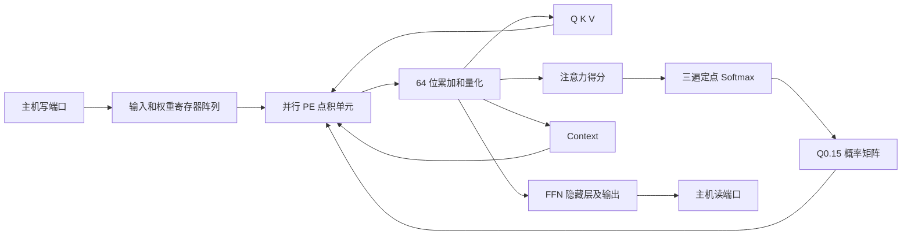
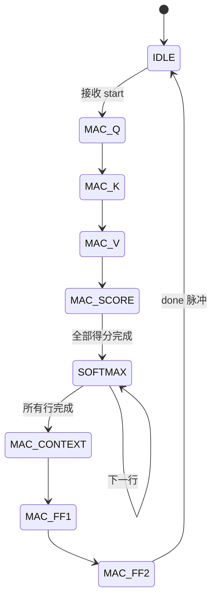

# INT8 Transformer 基线架构与数值约定

## 实现边界

本版本是可综合、寄存器存储、时分复用计算单元的教学基线。包含 QKV 投影、缩放点积单头注意力、Softmax、加权 V、两层 FFN（ReLU）。不包含 bias、位置编码、mask、残差、LayerNorm、多头或注意力输出投影，不声称是完整可部署的 Transformer 模型。

默认 N=4、D=8、F=16、LANES=2；N 是序列长度，D 是隐藏维度，F 是 FFN 中间维度。参数预期范围 1≤N≤64、1≤D≤256、1≤F≤256，LANES≥1。改变 D 时同时设置 SCALE=round(512/sqrt(D))。尺寸是综合时参数，不是运行时可写寄存器。

完整上限配置必须单独验证，不能由小尺寸通过推断最大配置 PPA 或功能已通过。当前验证范围以 `build/test_summary.json` 为准。

## 模块与数据流



`pe_array.v`：LANES 路并行乘积加归约；每拍处理一个输出点积的 LANES 个归约元素。当前不是二维脉动阵列；是否需要扩展成二维 PE 阵列需结合课程验收和后续面积结果评估。

`transformer_top.v`：同一个 PE 引擎依次执行 7 个矩阵乘阶段；最后一组不足 LANES 的元素补零。矩阵行主序存储。

`softmax_unit.v`：一行读三遍：最大值、指数和、归一化输出；指数 LUT 为 `exp_lut.v`。概率除法当前为可综合组合除法，尚未做时序/面积优化，需以 DC 结果决定是否改为迭代除法或倒数近似。



## 定点规则

输入、权重和投影/Context/FFN 输出均为有符号 INT8，数值解释为 raw/16。所有累加使用 64 位，右移为算术右移（负数向负无穷取整），阶段结束时饱和到 [-128,127]，不使用回绕溢出。默认移位 PROJ_SHIFT=FF_SHIFT=4。

```text
Q = sat8((X @ Wq) >>> 4)
K = sat8((X @ Wk) >>> 4)
V = sat8((X @ Wv) >>> 4)
S = sat8(((Q @ K.T) * SCALE) >>> (9 + SCORE_SHIFT))
SCALE = round(512 / sqrt(D)), SCORE_SHIFT = 4
```

S 为 Q4.4 有符号 logits。Softmax 对每行执行：

```text
m = max(S)
delta[j] = m - S[j]                 # 0..255
e[j] = floor(exp(-delta[j]/16) * 65536 + 0.5)
denom = sum(e)
P[j] = floor(e[j] * 32768 / denom) # 无符号 Q0.15
C = sat8((P @ V) >>> 15)
H = ReLU(sat8((C @ W1) >>> 4))
Y = sat8((H @ W2) >>> 4)
```

最大元素的指数为 65536，故正常输入下分母必大于零。P 可以等于 32768，因此不能作为 signed 16 位数读入 PE；RTL 将它零扩展到 signed 18 位。概率行和因向下取整可能小于 32768，不额外补齐。

这里的 Softmax 误差是相对于**量化得分 S/16 的浮点 Softmax**，不代表与浮点 Transformer 的端到端误差；目前未加载训练模型或评估模型精度。

## 主机接口

所有输入在 clk 上升沿采样。rst_n 为低有效异步复位，释放需要系统侧同步；复位清空状态机和计数，不清除矩阵数据。

| 信号 | 协议 |
| --- | --- |
| wr_en / wr_bank / wr_addr / wr_data | 仅 IDLE 且 start=0 时写；地址为元素下标，8 位有符号数据 |
| start | 仅 IDLE 且 wr_en=0 时接收；拉高一拍；忙时忽略 |
| busy | 计算期间为 1，拒绝主机写请求 |
| done | 全部输出完成时拉高一个时钟周期，同时 busy=0 |
| cycles | 从接收 start 后的第一拍计算到完成拍，包含 Softmax 调度，不含主机加载/读回 |
| rd_bank / rd_addr / rd_data | 组合读；完成后、下一次计算前读数据。内部未初始化数据不保证有效 |

写 bank：0=X[N,D]，1=Wq[D,D]，2=Wk[D,D]，3=Wv[D,D]，4=W1[D,F]，5=W2[F,D]。

读 bank：0=Y[N,D]，1=Q，2=K，3=V，4=S[N,N]，5=P[N,N]，6=Context[N,D]，7=H[N,F]。有符号数据符号扩展到 32 位；P 零扩展。非法读地址返回 0，非法写地址或 bank 忽略；没有额外错误响应端口。

输入和权重须在第一次 start 前全部写完。start 与 wr_en 同拍为 1 时不接受任一请求。复位后重算可复用已经完整加载的输入，但上次输出在新的 done 前视为无效。

## 周期模型与面积边界

计算拍数：

```text
3*N*D*ceil(D/LANES)        QKV
+ N*N*ceil(D/LANES)       QK.T
+ N*D*ceil(N/LANES)       P@V
+ N*F*ceil(D/LANES)       FF1
+ N*D*ceil(F/LANES)       FF2
+ N*(3*N+2)              Softmax 和握手
```

默认配置为 2048 次有效乘累加、1080 拍计算。这里只是周期计数；时钟频率必须以实验室约束及实际时序报告评估，不能据此宣称已达到某频率。

默认矩阵存储共 752 字节（含 16 位概率）；不含控制、累加器与 LUT。没有 SRAM 宏，SRAM 宏占比为 0；实际综合面积含寄存器、读写选择器、运算和控制逻辑。最大配置的寄存器存储规模会显著增大，本版不宣称其具有合理的 PPA。

## 算法与开源参考

- Attention Is All You Need，原始注意力与 FFN 定义：https://arxiv.org/abs/1706.03762 。
- Gemmini：https://github.com/ucb-bar/gemmini 。用于参考低精度矩阵乘、PE 复用、片上存储与外部搬运的架构划分。本版未复制 Gemmini RTL，不是其兼容实现，也未实现其二维脉动阵列或 SoC 接口。

本版与同类加速器的定量对比需等真实 DC/ICC 结果，并统一工艺、精度、频率、阵列规模、算子范围及存储口径，暂不填写对比数字。
