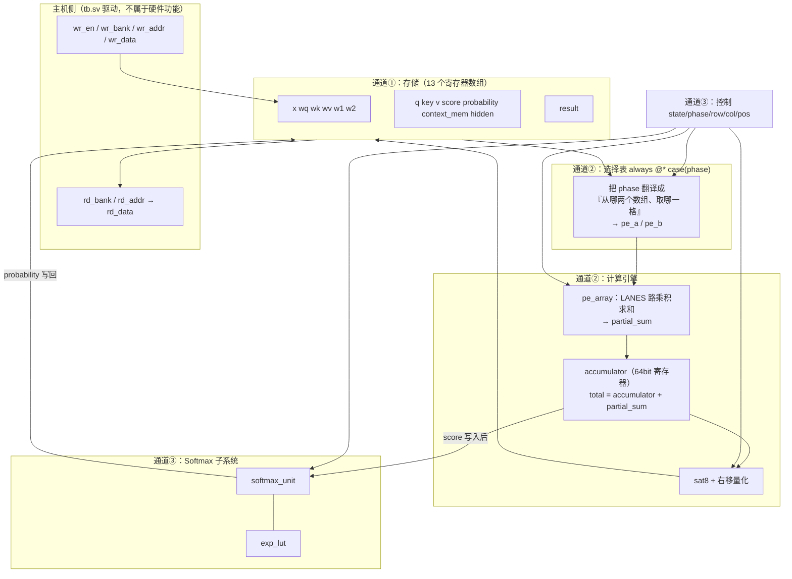

# 模块连接与数据流对照（连线版）

本文只回答一个问题：**四个 Verilog 文件之间到底靠哪几根线连起来，数据在时钟上一拍一拍怎么流。**
逐行语法解释看《[RTL 逐文件详解](RTL逐文件详解.md)》，数值格式看《[架构与数值约定](架构与数值约定.md)》。
所有信号名、行号、拍数都取自当前仓库代码，不是设想。

---

## 1. 一句话看懂整体

```text
一堆格子（存数字）  +  一台搅拌机（只算乘加）  +  一个值班表（决定这一刻搅哪两格）
```

对应到代码：

| 角色 | 现实里是什么 | 在 RTL 里是什么 |
| --- | --- | --- |
| 格子 | `x / wq / q / score / probability / hidden …` 共 13 个数组 | `transformer_top.v` 第 19–24 行的 `reg [7:0] …[0:…]` |
| 搅拌机 | 一台，反复用 | `pe_array.v` 实例 `pe`（第 50 行） |
| 特殊查表工 | 只会查指数 | `exp_lut.v` 实例 `lut`（`softmax_unit.v` 第 19 行） |
| 值班表 | 现在是第几阶段、第几行、第几列、加到第几个 | `state / phase / row / col / pos`（第 26–29 行） |

**关键认知：四个模块不是"四个并排的功能块"，而是"一台机器 + 一张调度表"。**
模块之间的联系不在数据流图上画四条平行箭头，而在那张**选择表（`case(phase)`）**上。

---

## 2. 模块之间只有三条通道

把顶层拆开，模块间的连接只有这三组线。看懂这三组，就看懂了全部联系。



### 通道①：存储 ↔ 计算（数据本身走的线）

只有两组总线，从选择表出来，进 PE：

```verilog
reg [LANES*18-1:0] pe_a, pe_b;        // 顶层 → pe_array 的两条输入总线，36 位
wire signed [63:0] partial_sum;       // pe_array → 顶层，唯一的一根结果线
```

`pe_array` 是**纯组合电路**：没有 `clk`，没有 `rst_n`，没有状态。给它 `a`、`b`，它立刻给 `sum`。
所以它和顶层的联系只是"两根进、一根出"，**它自己根本不知道现在是 Q 阶段还是 FFN 阶段**。
→ 这就是为什么"模块之间没什么联系"看起来成立：算力模块是无记忆的，**记忆全在顶层**。

### 通道②：选择表（模块联系真正的所在）

`transformer_top.v` 第 57–82 行是全部秘密。它做三件事：

```verilog
always @* begin
    inner_dim=D; columns=D;            // (a) 这一阶段点积多长、输出几列
    if(phase==3) columns=N;
    if(phase==4) inner_dim=N;
    if(phase==5) columns=F;
    if(phase==6) inner_dim=F;
    ...
    if(state==MAC && idx<inner_dim) begin
        case(phase)                    // (b) 这一阶段读哪两个数组
            0: begin aa=x[row*D+idx];        bb=wq[idx*D+col];  end
            3: begin aa=q[row*D+idx];        bb=key[col*D+idx]; end
            4: begin aa=$signed({2'b00,probability[row*N+idx]}); bb=v[idx*D+col]; end
            ...
        endcase
    end
    pe_a[lane*18 +: 18]=aa;            // (c) 拼到 PE 的输入总线上
end
```

看 `case` 的**左列永远是"被乘的行向量"，右列永远是"权重的列向量"**。
7 个阶段用的**是同一段代码结构**，只是换了两个数组名和两个地址算式。

三个细节，正好是你画图时最该标出来的"联系"：

1. **`phase==3` 的右操作数 `key[col*D+idx]`**：写的是 `col` 在前、`idx` 在后。
   这就是"K 转置"在硬件里的全部体现——**没有真的搬数据，只是把下标顺序换了一下**。
   算法图上的 `Q × Kᵀ`，落到代码就是一个下标对调。
2. **`phase==4` 的左操作数要 `{2'b00, probability[...]}`**：概率是 16 位无符号（最大 32768），
   塞不进 8 位。所以 PE 的输入做成 **18 位有符号**，别的阶段高位补符号、这个阶段补零。
   → 这就是"数据格式"如何把两个模块绑在一起。
3. **`state==MAC` 这个条件**：只要不在 MAC 状态（比如在做 softmax），`aa/bb` 直接是 0。
   非 MAC 时 PE 在算 0+0，白白费电但无害——**顶层靠这一句把计算引擎"挂空挡"**。

### 通道③：握手线（顶层和 softmax 之间那 6 根）

这是全工程唯一一处**两个有时序的状态机在对话**，也是最容易看不懂的地方。

```verilog
softmax_unit #(.N(N)) sm(
    .clk(clk), .rst_n(rst_n),
    .start(state==SM_START),              // 顶层 → sm：这一行开算
    .read_addr(sm_read),                  // sm → 顶层：我要读这一格
    .logit(sm_logit),                     // 顶层 → sm：这就是那一格的值
    .valid(sm_valid), .index(sm_index), .prob(sm_value),  // sm → 顶层：第 index 个概率是 prob
    .done(sm_done)                        // sm → 顶层：这一行 4 个概率全发完了
);
```

配合第 38 行这一根**读回线**：

```verilog
wire signed [7:0] sm_logit = score[row*N + sm_read];
```

读一遍这三行，就读懂了 Softmax 怎么被"喂"：

- `sm` 里有个指针 `ptr`（0→3），从 `read_addr` 送出来；
- 顶层拿它当偏移，去 `score` 里取**当前行** `row` 的那个数，从 `logit` 送回；
- 于是 `sm` 每拍读一个、三遍都这么读，**它自己完全不认识 score 数组**——数组在顶层，`sm` 只会问"第几个？""给你这个数"。

> **`softmax_unit` 是一个"要数据靠别人递到手边"的模块。**
> 它不接存储器，只接一对 `read_addr / logit` 的手手（读口）。
> 顶层 `row` 和 `sm` 内部 `ptr` 一个管行、一个管列，两者合起来才等于 `score[row][ptr]`。

---

## 3. 七个阶段一张表（算法 ↔ 代码 ↔ 拍数）

默认 `N=4, D=8, F=16, LANES=2`。`phase` 从 0 跑到 6，`state` 全程是 `MAC`（只有第 3 到第 4 阶段之间跳出去做 softmax）。

| phase | 算法在算什么 | 左数组 `aa` | 右数组 `bb` | 长度 `inner_dim` | 输出列 `columns` | 结果写进 | 收尾处理 | 代码行 | 拍数 |
| --- | --- | --- | --- | --- | --- | --- | --- | --- | --- |
| 0 | `Q = X·Wq` | `x` | `wq` | D=8 | D=8 | `q` | `>>>4` 饱和 | 69 / 124 | 4×8×4 = **128** |
| 1 | `K = X·Wk` | `x` | `wk` | 8 | 8 | `key` | `>>>4` | 70 / 125 | **128** |
| 2 | `V = X·Wv` | `x` | `wv` | 8 | 8 | `v` | `>>>4` | 71 / 126 | **128** |
| 3 | `S = Q·Kᵀ·scale` | `q` | `key`（下标对调＝转置） | 8 | **N=4** | `score` | `×181 >>13` | 72 / 127 | **64** |
| — | 逐行三遍 Softmax | 走 `sm`，不走 PE | | | | `probability` | 除法 | 148–155 | 4×14 = **56** |
| 4 | `C = P·V` | `probability`（16bit 补零） | `v` | **N=4** | 8 | `context_mem` | `>>>15` | 73 / 128 | **64** |
| 5 | `H = ReLU(C·W1)` | `context_mem` | `w1` | 8 | **F=16** | `hidden` | `>>>4`，负数清零 | 74 / 129–130 | **256** |
| 6 | `Y = H·W2` | `hidden` | `w2` | **F=16** | 8 | `result` | `>>>4` | 75 / 131 | **256** |

合计 **1024 + 56 = 1080 拍**。`tb.sv` 第 35 行断言的正是这个数，`cycles` 计数器把它测出来了。

拍数公式（写报告可以直接用）：

```text
MAC 阶段拍数 = N × columns × ceil(inner_dim / LANES)
Softmax 拍数 = N × (1 + 3N + 1)      ← 每行：1 拍 start + 三遍各 N 拍 + 1 拍才看到 done
```

**这张表就是你该画的"数据流图"的正文。** 图上每个箭头都能指到某一行代码，答辩才站得住。

---

## 4. 逐拍走一遍：一个点积怎么算出来

取 `phase=0`（算 Q）、`row=0, col=0`，即求 `q[0][0] = X第0行 · Wq第0列`。D=8、LANES=2，四拍完成。

```text
拍号  pos  lane0 取的 aa / bb          lane1 取的 aa / bb        partial_sum      这一拍结束 accumulator
 1     0   x[0*8+0]=X[0,0]             x[0*8+1]=X[0,1]           X00*W00+X01*W10   0 + partial_sum
 2     2   x[0*8+2]=X[0,2]             x[0*8+3]=X[0,3]           X02*W20+X03*W30   上一拍 + 本拍
 3     4   x[0*8+4]=X[0,4]             x[0*8+5]=X[0,5]           …                 累加
 4     6   x[0*8+6]=X[0,6]             x[0*8+7]=X[0,7]           …                 这一拍：pos+LANES>=8 成立
                                                                   → 写 q[0*8+0] = sat8(total >>> 4)
                                                                     col<=1（下一个输出元素）
```

三个必须理解的点：

- **`total = accumulator + partial_sum` 是组合逻辑（第 34 行）**，同一拍就把 PE 结果并进累加器；
  第 146 行 `accumulator <= total` 用非阻塞赋值把它存下来。**一拍吞掉 LANES 个乘积**，这就是吞吐率的全部来源。
- 第 4 拍 `pos+LANES>=inner_dim` 成立时**该拍不累加**，而是"输出 + 复位 `pos`"。
  所以 `accumulator<=0` 紧跟其后，为下一个点积腾地方。
- `pos` 每次跳 `LANES`（0→2→4→6），**不是 0→1→2**。`idx = pos + lane` 让 lane 提供并行、`pos` 提供串行推进。

**把这段画成时序图（4 个时钟周期 × 5 行信号），课设报告的"实现细节"就有了。**

---

## 5. 逐拍走一遍：Softmax 的握手（那多出来的 4 拍从哪来）

以 `row=0` 的一行 `score` 为例，`N=4`：

```text
顶层 state   sm.state  sm.ptr  sm_read  sm_logit         sm.valid sm.done   说明
SM_START       0         0     （无关）   （无关）          0        0       start=1 只有一拍；sm 把 maximum 置 -128
SM_WAIT        1         0       0      score[0]          0        0       第 1 遍：找最大值
SM_WAIT        1         1       1      score[1]          0        0
SM_WAIT        1         2       2      score[2]          0        0
SM_WAIT        1         3       3      score[3]          0        0       ptr==N-1 → 转 state 2
SM_WAIT        2         0       0      score[0]          0        0       第 2 遍：LUT 求和，累进 denominator
SM_WAIT        2         3       3      score[3]          0        0       ptr==N-1 → 转 state 3
SM_WAIT        3         0       0      score[0]          1        0       第 3 遍：prob = exp<<15 / denominator
SM_WAIT        3         3       3      score[3]          1        0       顶层把 4 个概率写进 probability[0*4+idx]
SM_WAIT        0         0       …      …                 0        1       ← done 在这一拍才拉高
SM_START      …          …      …      …                 0        0       顶层"下一拍"才看到 done，才切 row
```

数一下：**1 + 12 + 1 = 14 拍一行**，4 行 56 拍。多出来的那 1 拍是**寄存器输出的延迟**：
`done` 是 `output reg`，在 `ptr==N-1` 那一拍的末尾才 `<=1`，顶层要到下一拍才进 `if(sm_done)` 分支。
`valid/index/prob` 同理，都是 `sm` 里打了一拍才出来。
**"我决定了"和"对方看见了"之间永远差一拍**——这是数字设计里最普遍的一条联系规则，
工程里所有的握手问题都是它。

---

## 6. 主机侧的连接（也是模块联系，别漏）

数据进得来、出得去，靠 `wr_bank` / `rd_bank` 两个 3 位"货架编号"。
**写口和读口是两张不同的表，编号不通用**，这是很容易看漏的地方：

| 编号 | 写入口 `wr_bank`（第 104–113 行） | 读出口 `rd_bank`（第 84–96 行） |
| --- | --- | --- |
| 0 | `x` | `result` ← **最终输出** |
| 1 | `wq` | `q` |
| 2 | `wk` | `key` |
| 3 | `wv` | `v` |
| 4 | `w1` | `score` |
| 5 | `w2` | `probability`（16 位，高位补 0） |
| 6 | —— | `context_mem` |
| 7 | —— | `hidden` |

三条要点：

1. **只在 `state==IDLE` 且没同时 `start` 时才允许写**（第 104 行）。
   跑起来之后写请求被忽略——这是"忙时请求不得破坏本次计算"的实现，`tb.sv` 第 30–31 行专门测它。
2. **中间结果全部可读**：`q/k/v/score/probability/context/hidden` 都能读出来和 NumPy 逐阶段比对。
   94,038 次比较就是靠这个读口做的。**这是本工程验证能这么强的真正原因。**
3. 权重 `wq/wk/wv/w1/w2` **写进去读不出来**（读口的 1/2/3 是 q/k/v）。要回读权重得改代码，目前不需要。

---

## 7. 老师问"你的 PE 阵列在哪"，怎么答

当前是一个 **LANES 路的乘加单元 + 时分复用**，不是二维脉动阵列：

```text
算法图上的 7 个矩阵乘   →   硬件上只有 1 个 pe_array，靠 phase 依次复用 7 轮
```

理由（也是可写进报告的设计权衡）：

- 注意力这套计算里，**唯一的算力原语就是点积**。7 个阶段结构相同，只是操作数来源不同 → 复用一套硬件，面积换时间。
- 代价：延迟变成"所有阶段串起来"，即第 3 节那张表里的 1080 拍。
- 若改成二维 PE 阵列（`row × col` 全并行），拍数下降到 `ceil(inner_dim)` 一级，但寄存器阵列与多路选择器面积按 `N×D×D` 上涨。

**先确认老师对"PE 阵列"的字面要求。** 若必须二维阵列，改动集中在第 57–82 行的选择表和 `pe_array` 的端口，
顶层状态机（`row/col/pos` 的推进逻辑）与 softmax、主机接口都不用动——这就是当前分层的好处，值得在报告里点出来。

---

## 8. 画图的顺序建议（照这个画，别一上来画大图）

1. **第一张：物理连接图**（唯一必须画对的一张）
   画 3 个框：`存储阵列组`、`pe_array`、`softmax_unit(+exp_lut)`，外面一个大框写 `transformer_top 状态机`。
   线只画四类：`pe_a/pe_b`、`partial_sum`、`accumulator` 回写、`read_addr/logit/valid/index/prob/done`。
   每条线标位宽（18×LANES、64、16、8、1）。
2. **第二张：phase 时间轴**
   横轴一条带，切成 `0 Q | 1 K | 2 V | 3 S | SM | 4 C | 5 H | 6 Y`，底下标拍数 128/128/128/64/56/64/256/256。
   **这张图同时表达"算法数据流"和"硬件时分复用"**，比画七个大矩阵乘的图更贴近真实电路。
3. **第三张：一个点积的四拍波形**（第 4 节）
   `clk / state / phase / row,col / pos / aa,bb / partial_sum / accumulator / 写回`。
   这张图最能证明你"懂 RTL"，答辩被追问时靠它。

《架构与数值约定》里那张 flowchart 画的是**算法关系**，容易被误读成"有 7 套乘法器硬件"。
答辩时主动说清这一点，比被老师问出来好。

---

## 9. 自检：能答上这 6 题才算通了

1. `phase=3` 里为什么 `bb=key[col*D+idx]` 而不是 `key[idx*D+col]`？（提示：转置 = 下标对调）
2. `pe_array` 为什么可以没有 `clk`？没有时钟它靠什么工作？
3. Softmax 期间 `pe_array` 在算什么？为什么不会算错？（提示：第 67 行 `state==MAC`）
4. 概率为什么要补成 18 位？直接用 8 位会怎样？（提示：32768）
5. 把 `LANES` 从 2 改成 4，总拍数怎么变？哪个阶段完全不变？（提示：softmax 的 56 拍与 LANES 无关）
6. 把 `D` 从 8 改成 12、`LANES=2`，`phase=0` 要几拍？`pos` 序列是什么？
   （答：`ceil(12/2)=6` 拍，`pos=0,2,4,6,8,10`；最后一拍 `10+2>=12` 成立）

答案都在第 2、3、4、5 节里，对着代码行号自己找一遍，比看解析有用。

---

## 10. 和老师模板 `sm2` 的接线（下一步要做的）

`D:\class\EDA\sm2\syn\rtl` 目前是空的，旧 `run_dc.tcl` 还引用 `ECC256 / mod256 / HDMI_ENCODER`。
要放的 RTL 就是这四行（`rtl/files.f`）：

```text
rtl/pe_array.v
rtl/exp_lut.v
rtl/softmax_unit.v
rtl/transformer_top.v
```

模板里要改的四个名字：

| 项目 | 值 |
| --- | --- |
| 顶层模块 | `transformer_top` |
| 时钟端口 | `clk` |
| 复位端口 | `rst_n`（低有效，异步） |
| 报告目录/前缀 | 换成本工程自己的名字，别覆盖旧设计的报告 |

**复制一份模板再改，不要动 `D:\class\EDA\sm2` 原件。**
